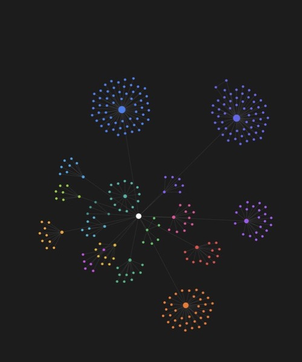

# Selective Agent Library for Claude Code & Codex

English | [Türkçe](README.tr.md)

A portable, safety-oriented specialist library for Claude Code App and Codex.
Add this repository beside any project as an **additional workspace folder**.
The active coding agent discovers one router skill, searches a compact catalog,
and reads only the few specialist profiles that materially help with the task.

No global installation. No per-task router prompt. No loading hundreds of agent
profiles into context.

## Why this structure

- **Selective loading:** one canonical router indexes 269 specialist profiles
  for both Claude Code and Codex, with quarantined profiles excluded.
- **Project-first:** the active project's code and instructions remain the source
  of truth.
- **Context isolation:** an optional Second-Brain folder remains a separate
  knowledge source and is never bundled with this repository.
- **Safety controls:** quarantined profiles are excluded and consequential actions
  always require explicit user approval.
- **Human-friendly navigation:** an optional Obsidian graph groups profiles into
  17 color-coded categories.
- **Traceable upstream:** the source library is a pinned Git submodule, preserving
  its history and license.

## Quick start

Requirements: Git, Bash, and Claude Code App and/or Codex. Obsidian is optional.

```bash
git clone --recurse-submodules https://github.com/Tngc93/claude-codex-agent-library.git AI-Agents
cd AI-Agents
./scripts/setup.sh
```

If you already cloned without submodules:

```bash
git submodule update --init --recursive
./scripts/setup.sh
```

## Use in Claude Code App

When starting a **Code / Local** session:

1. Select your actual project as the main working folder.
2. Add this `AI-Agents` folder as an additional working directory.
3. Optionally add your own `Second-Brain` folder as another, separate working
   directory.
4. Describe the project task normally. Do not name an agent or paste a router
   prompt.

Claude Code discovers `.claude/skills/workspace-router/SKILL.md` from the added
directory. For a non-trivial task, the router searches the small TSV catalog,
selects one primary profile and, only when useful, up to two complementary
reviewers. It then reads only those source profiles.

## Use in Codex App

When starting a local Codex task:

1. Select your actual project as the primary workspace.
2. Add this `AI-Agents` repository as another workspace folder.
3. Optionally add your own `Second-Brain` folder separately.
4. Describe the project task normally; Codex can invoke the router implicitly.

Codex discovers the same router through `.agents/skills/workspace-router`. That
path is a relative symbolic link to the canonical Claude skill, so the two tools
cannot drift into different routing rules. If a newly cloned skill does not
appear immediately, restart Codex once.

## Separation of concerns

| Source | Purpose | Write policy |
|---|---|---|
| Current project | Code, requirements, and primary truth | Main task target |
| Second-Brain (optional) | Prior decisions and personal context | Read-only unless explicitly requested |
| AI-Agents | Specialist methods and review lenses | Source profiles are read-only |

Second-Brain is not part of this repository. Setup and maintenance scripts do
not discover, copy, reorganize, or modify it.

## Safety model

- Upstream profiles are treated as untrusted advisory instructions.
- User requests, project instructions, observed code, and host permission controls
  always take precedence.
- External publishing, messaging, deployment, credential use, scheduled jobs,
  purchases, and destructive or irreversible actions require explicit approval.
- `marketing/marketing-carousel-growth-engine.md` is quarantined and excluded
  from both the routing catalog and Obsidian map.
- Scripts mentioned by upstream profiles are never executed merely because a
  profile requests it.

## Obsidian graph

Open this directory as an Obsidian vault for a visual map:



The white center node is `Ana Sayfa`, the library's navigation root. Each large
colored node is one specialist category, and the smaller nodes around it are the
profiles in that category. This keeps domains visually separated instead of
mixing every profile into one undifferentiated graph.

```text
Ana Sayfa → 17 category hubs → specialist profiles
```

The Turkish filename `Ana Sayfa` means “Home”. Category hubs are color-coded and
larger than profile nodes. This map is for human navigation; Claude Code and Codex
route through the compact catalog independently of Obsidian.

## Repository layout

```text
AI-Agents/
├── .claude/skills/workspace-router/  # canonical router + Claude discovery
├── .agents/skills/workspace-router   # Codex link to the canonical router
├── agency-agents/                    # pinned upstream Git submodule
├── Agent Kütüphanesi/                # generated Obsidian category maps
├── config/                            # quarantine and reproducible settings
├── scripts/                           # setup, generation, and validation
├── Ana Sayfa.md                       # Obsidian graph entry point
├── AGENTS.md                           # Codex maintenance rules
├── CLAUDE.md                          # repository maintenance rules
└── README.md
```

## Maintenance

After reviewing and intentionally updating the upstream revision:

```bash
./scripts/build-agent-catalog.sh
./scripts/build-obsidian-agent-map.sh
./scripts/validate.sh
```

Do not edit upstream profiles inside this wrapper repository. See
[CONTRIBUTING.md](CONTRIBUTING.md) for the safe update process.

## Attribution and license

The dual Claude/Codex discovery layer, selective router, safety controls, catalog
tooling, and Obsidian map are original work maintained in this repository and are
MIT licensed. The specialist profile bodies come from the attributed upstream
project and remain subject to its MIT license. See
[THIRD_PARTY_NOTICES.md](THIRD_PARTY_NOTICES.md) for provenance and the pinned
revision.
